# Specify - Lagos Logistics & Order Fulfillment Management System

[](https://nextjs.org/)
[](https://react.dev/)
[](https://www.typescriptlang.org/)
[](https://tailwindcss.com/)
[](https://supabase.com/)
[](https://ai.google.dev/)

An enterprise-grade, real-time logistics and fulfillment management platform built specifically for high-velocity urban logistics operations in Lagos, Nigeria. Specify connects customer service representatives, warehouse inventory handlers, field dispatch managers (FOMs), accounting officers, and third-party merchants into an unified, synchronized operational pipeline.

---

## 📑 Table of Contents

- [Core Features](#-core-features)
- [Operational Workflow](#-operational-workflow)
- [Role-Based Architecture](#-role-based-architecture)
- [Tech Stack](#-tech-stack)
- [Project Structure](#-project-structure)
- [Prerequisites](#-prerequisites)
- [Local Setup & Installation](#-local-setup--installation)
  - [1. Clone Repository & Install Dependencies](#1-clone-repository--install-dependencies)
  - [2. Configure Environment Variables](#2-configure-environment-variables)
  - [3. Supabase Database & Schema Setup](#3-supabase-database--schema-setup)
  - [4. Create Authentication & Demo Users](#4-create-authentication--demo-users)
  - [5. Run Development Server](#5-run-development-server)
- [Demo User Accounts](#-demo-user-accounts)
- [Public & Merchant Portals](#-public--merchant-portals)
- [Available Scripts](#-available-scripts)
- [Troubleshooting & FAQs](#-troubleshooting--faqs)

---

## 🚀 Core Features

- **🤖 AI-Powered Order Extraction**: Integrates Google Gemini AI (`@google/generative-ai`) to parse messy, unstructured order texts (e.g., from WhatsApp chats, Instagram DMs, SMS) directly into validated JSON schemas (customer name, delivery address, phone numbers, items, quantities, and totals).
- **⚡ Real-Time Operational Floor**: Powered by Supabase Realtime (PostgreSQL logical replication). When an order status updates or a rider is dispatched, every team dashboard updates instantly with zero page reloads.
- **🛡️ Granular Role-Based Access Control (RBAC)**: Role protection and UI layouts for 5 core operational roles plus merchants and consumers.
- **📍 Lagos Delivery Zoning & Landmark Engine**: Landmark-based route fee calculation for accurate delivery pricing across Lagos districts and dispatch zones.
- **💰 Automated Financial Reconciliation**:
  - Auto-calculates net payments to merchants (`amount_paid - landmark_fee`).
  - Automatically adjusts rider payout on delivery failures (e.g. 50% commission retention for failed delivery attempts via database triggers).
  - Invoice and receipt generation with PDF (`jspdf`, `jspdf-autotable`) and spreadsheet exports (`xlsx`, `docx`).
- **🔍 Public Consumer Tracking**: End-customers can track their packages in real time at `/track` using their unique Order ID without needing to log in.
- **🏪 External Merchant Portal**: Dedicated multi-tier access (`/merchant`) with access-key authentication for merchants to submit stock entries, track inventory levels, and review order statuses.

---

## 🔄 Operational Workflow

```mermaid
flowchart LR
    A[Raw Order / WhatsApp] -->|AI Extraction via Gemini| B(Customer Service)
    B -->|Create & Validate Order| C(Warehouse)
    C -->|Pack & Verify Stock| D(Field Operations / FOM)
    D -->|Assign Rider & Dispatch| E[Rider Delivery in Lagos]
    E -->|Delivered / Failed| F(Accounting)
    F -->|Confirm Payment & Remit| G[Merchant Settlement & Invoice]
```



1. **Intake & Extraction**: Customer Service captures order details manually or pastes raw customer chats into the Gemini AI extractor.
2. **Inventory Verification**: The Warehouse team verifies product availability, packs items, and marks stock status (`packed`, `unpacked`, or `out-of-stock`).
3. **Dispatch & Routing**: FOM (Field Operations Manager) assigns in-house or external riders, maps landmark delivery zones, and tracks dispatch status (`pending`, `shipped`, `delivered`, `failed`).
4. **Payment & Reconciliation**: Accounting confirms customer remittances, balances COD (Cash On Delivery) collections, reconciles rider pay, and generates merchant payout reports.

---

## 🎯 Role-Based Architecture

| Role | Route | Key Responsibilities |
|---|---|---|
| **Customer Service** | `/dashboard/customer_service` | Order creation, Gemini AI text parsing, order status progression, customer inquiries management, fulfillment tracking. |
| **Warehouse** | `/dashboard/warehouse` | Packaging queues, stock level audits, out-of-stock flag resolution, product inventory tracking. |
| **FOM (Field Operations)** | `/dashboard/fom` | Dispatch dashboard, rider assignments (in-house vs. 3rd-party), landmark route mapping, delivery failure audits. |
| **Accounting** | `/dashboard/accounting` | Bank remittance confirmation, rider payment approvals, automated merchant remittance calculation, PDF/Excel invoice creation. |
| **Administrator** | `/dashboard/admin` | Platform-wide analytics, user account lifecycle management (create users, set passwords, toggle status), system settings. |
| **Merchant** | `/merchant` | Multi-role merchant portal (admin, warehouse, customer service, guest) for stock counting, catalog submissions, and inventory status. |
| **Public Consumer** | `/track` | Public-facing order status tracker using Order ID. |

---

## 💻 Tech Stack

- **Framework**: [Next.js 16](https://nextjs.org/) (App Router, Server & Client Components)
- **UI Library**: [React 19](https://react.dev/)
- **Styling**: [Tailwind CSS v4](https://tailwindcss.com/) + [shadcn/ui](https://ui.shadcn.com/)
- **Icons**: [Lucide React](https://lucide.dev/)
- **State & Tables**: [TanStack Table v8](https://tanstack.com/table) & [TanStack Virtual](https://tanstack.com/virtual)
- **Database & Auth**: [Supabase](https://supabase.com/) (PostgreSQL 15+, Supabase Auth, Row Level Security, Triggers & Realtime)
- **AI Processing**: [Google Gemini API](https://ai.google.dev/) (`gemini-2.5-flash` / `@google/generative-ai`)
- **Document Generation**: `jspdf`, `jspdf-autotable`, `xlsx`, `docx`
- **Charts & Visualizations**: [Recharts](https://recharts.org/)

---

## 📁 Project Structure

```text
specify/
├── app/
│   ├── api/
│   │   ├── admin/                # Admin user management & password endpoints
│   │   ├── gemini/extract-order/ # Gemini AI order text parsing endpoint
│   │   └── merchant/session/     # Merchant cookie-based session verification
│   ├── dashboard/                # Internal operational dashboards
│   │   ├── accounting/           # Invoices, payments, and rider remittances
│   │   ├── admin/                # Users, orders management, and system settings
│   │   ├── customer_service/     # Order creation, AI extraction, and inquiries
│   │   ├── fom/                  # Dispatch board, rider assignments, deliveries
│   │   └── warehouse/            # Inventory, packing queue, out-of-stock items
│   ├── login/                    # Staff authentication portal
│   ├── merchant/                 # Dedicated merchant portal & stock approvals
│   ├── track/                    # Public-facing customer order tracking
│   ├── layout.tsx                # Root layout & providers
│   └── page.tsx                  # Root redirection
├── components/                   # Reusable UI components & shadcn primitives
│   ├── ui/                       # shadcn/ui base elements (Button, Dialog, Table, etc.)
│   ├── auth-context.tsx          # Supabase auth session provider
│   └── login-form.tsx            # Login form component
├── hooks/                        # Custom hooks (e.g. useRealtimeOrders, useAuth)
├── lib/
│   ├── api/                      # Role-specific data service functions
│   ├── merchant-session.ts       # Merchant session utilities
│   ├── supabase.ts               # Supabase browser client initialization
│   ├── types.ts                  # TypeScript schemas mirroring database definitions
│   └── utils.ts                  # Formatting (NGN Currency, Dates) and helpers
├── public/                       # Static branding assets and images
└── sql/
    └── db.sql                    # Full PostgreSQL schema, enums, triggers, and RLS policies
```

---

## ⚙️ Prerequisites

Before you begin, ensure you have installed:

- **Node.js**: `v18.18.0` or higher (Node.js 20+ LTS recommended)
- **Package Manager**: `npm` (comes with Node), `pnpm`, or `yarn`
- **Supabase Account**: A free project on [supabase.com](https://supabase.com) (or a local Supabase CLI instance)
- **Google AI Studio Key**: A free Gemini API key from [Google AI Studio](https://aistudio.google.com/app/apikey)

---

## 🛠️ Local Setup & Installation

Follow these steps to get Specify running on your local machine:

### 1. Clone Repository & Install Dependencies

```bash
git clone https://github.com/your-username/specify.git
cd specify
npm install
```

### 2. Configure Environment Variables

Create a `.env.local` file by copying the sample template:

```bash
cp .env.example .env.local
```

Open `.env.local` and populate the required variables:

```env
# ==============================================================================
# Supabase Configuration
# Found in: Supabase Dashboard -> Project Settings -> API
# ==============================================================================
NEXT_PUBLIC_SUPABASE_URL=https://your-project-id.supabase.co
NEXT_PUBLIC_SUPABASE_PUBLISHABLE_KEY=your-anon-publishable-key
SUPABASE_SERVICE_ROLE_KEY=your-supabase-service-role-key

# ==============================================================================
# Google Gemini AI API Configuration
# Get your free key at: https://aistudio.google.com/app/apikey
# ==============================================================================
GOOGLE_GEMINI_API_KEY=your-primary-gemini-api-key

# Optional: Gemini API key rotation slots (used if primary key hits rate limits)
# GOOGLE_GEMINI_API_KEY_I=
# GOOGLE_GEMINI_API_KEY_II=

# ==============================================================================
# Staff Account Default Provisioning Password
# Used when the Admin creates new staff users via the Admin dashboard
# ==============================================================================
DEFAULT_USER_PASSWORD=YourSecureTemporaryPassword123!
```

> [!IMPORTANT]
> The `SUPABASE_SERVICE_ROLE_KEY` is strictly used by server-side API routes (`/api/admin/*`) to manage users and bypass RLS where appropriate. Never expose this key in client-side code (`NEXT_PUBLIC_`).

---

### 3. Supabase Database & Schema Setup

1. Open your Supabase project dashboard.
2. Navigate to the **SQL Editor** from the left navigation bar.
3. Open [`sql/db.sql`](sql/db.sql) in this repository, copy its full contents, paste them into the SQL Editor, and click **Run**.

This script will automatically:
- Enable the `pgcrypto` extension.
- Create all custom Postgres ENUM types (`delivery_status`, `inventory_status`, `rider_type`, `role`).
- Create all tables: `users`, `landmarks`, `riders`, `settings`, `customer_inquiries`, `merchants`, `merchant_access_keys`, `products`, `orders`, and `stock_entries`.
- Apply indexes, triggers (including automatic rider fee halving on failed deliveries and merchant remittance calculations), and permissive Row Level Security policies.
- Insert starter profile rows in `public.users`.

#### Enable Supabase Realtime Replication

To ensure order updates stream live across all dashboards:
1. In the Supabase Dashboard, navigate to **Database** -> **Replication**.
2. Find the `supabase_realtime` publication.
3. Ensure the **`orders`** and **`users`** tables are toggled **ON** for replication (or execute the following SQL in the SQL Editor):

```sql
alter publication supabase_realtime add table public.orders;
alter publication supabase_realtime add table public.users;
```

---

### 4. Create Authentication & Demo Users

`public.users` stores profile metadata (role, display name), while `auth.users` manages passwords and login sessions. The `id` in `public.users` must match the `id` of the user in Supabase Auth.

You can set up the demo users in one of two ways:

#### Option A: Direct SQL Creation (Fastest)

Run this SQL query in your Supabase SQL Editor to insert the demo users into Supabase Auth with password `Password123!` and match them to the predefined profiles in `public.users`:

```sql
-- Enable pgcrypto if not already enabled
create extension if not exists pgcrypto;

-- Insert auth records matching pre-seeded profile UUIDs
insert into auth.users (
  instance_id,
  id,
  aud,
  role,
  email,
  encrypted_password,
  email_confirmed_at,
  recovery_sent_at,
  last_sign_in_at,
  raw_app_meta_data,
  raw_user_meta_data,
  created_at,
  updated_at,
  confirmation_token,
  email_change,
  email_change_token_new,
  recovery_token
)
values
  ('00000000-0000-0000-0000-000000000000', '35d2a581-2b8c-46c0-845a-35fe68f0379b', 'authenticated', 'authenticated', 'admin@specify.com', crypt('Password123!', gen_salt('bf')), now(), null, null, '{"provider":"email","providers":["email"]}', '{"display_name":"Admin User"}', now(), now(), '', '', '', ''),
  ('00000000-0000-0000-0000-000000000000', 'f33f8eea-e3a2-4be9-a3d2-babd3c51fa8a', 'authenticated', 'authenticated', 'cs@specify.com', crypt('Password123!', gen_salt('bf')), now(), null, null, '{"provider":"email","providers":["email"]}', '{"display_name":"Customer Service"}', now(), now(), '', '', '', ''),
  ('00000000-0000-0000-0000-000000000000', '7fe87941-e929-4011-804f-49bd9780b723', 'authenticated', 'authenticated', 'warehouse@specify.com', crypt('Password123!', gen_salt('bf')), now(), null, null, '{"provider":"email","providers":["email"]}', '{"display_name":"Warehouse User"}', now(), now(), '', '', '', ''),
  ('00000000-0000-0000-0000-000000000000', '8ea93c71-0287-4a49-a1ab-c31006e532f8', 'authenticated', 'authenticated', 'fom1@specify.com', crypt('Password123!', gen_salt('bf')), now(), null, null, '{"provider":"email","providers":["email"]}', '{"display_name":"FOM User"}', now(), now(), '', '', '', ''),
  ('00000000-0000-0000-0000-000000000000', '31941faa-0632-4f56-ab46-55cc3bec2f33', 'authenticated', 'authenticated', 'accounting@specify.com', crypt('Password123!', gen_salt('bf')), now(), null, null, '{"provider":"email","providers":["email"]}', '{"display_name":"Accounting User"}', now(), now(), '', '', '', '')
on conflict (id) do nothing;
```

#### Option B: Via Supabase Dashboard

1. Navigate to **Authentication** -> **Users** in your Supabase Dashboard.
2. Click **Add User** -> **Create User**.
3. Create a user (e.g., `admin@specify.com`) with a password of your choice and toggle **Auto Confirm User?** to ON.
4. Copy the generated User UID.
5. In the SQL Editor, update the corresponding profile row:
   ```sql
   UPDATE public.users SET id = '<COPIED_AUTH_UID>' WHERE email = 'admin@specify.com';
   ```

---

### 5. Run Development Server

```bash
npm run dev
```

Open [http://localhost:3000](http://localhost:3000) in your browser. You will be redirected to `/login`.

---

## 👥 Demo User Accounts

If you created the users via Option A above, log in with password: **`Password123!`**

| Email | Role | Landing Dashboard | Primary Functions |
|---|---|---|---|
| `admin@specify.com` | `admin` | `/dashboard/admin` | Full system control, analytics, user management, and system settings. |
| `cs@specify.com` | `customer_service` | `/dashboard/customer_service` | AI order extraction, manual order intake, inquiry tickets. |
| `warehouse@specify.com` | `warehouse` | `/dashboard/warehouse` | Stock status, packing queues, out-of-stock management. |
| `fom1@specify.com` | `fom` | `/dashboard/fom` | Dispatch board, rider assignment, route status tracking. |
| `accounting@specify.com` | `accounting` | `/dashboard/accounting` | Payment verification, merchant remittances, invoices, rider fees. |

---

## 🌐 Public & Merchant Portals

### 1. Public Order Tracking (`/track`)
Customers can navigate directly to `http://localhost:3000/track` and enter an **Order ID** to track delivery status, assigned dispatch information, and order timeline without requiring login.

### 2. Merchant Portal (`/merchant/login`)
Merchants access their dedicated inventory and approval interface via `/merchant/login`.
- **Guest Access**: Explore merchant features in read-only mode without credentials.
- **Role Keys**: Authenticated staff or merchants can supply access keys configured in `merchant_access_keys` to submit new inventory batches and stock changes.

---

## 📜 Available Scripts

In the project root, you can run:

```bash
# Start development server with hot-reload
npm run dev

# Run TypeScript compilation and create optimized production build
npm run build

# Start the Next.js production server
npm run start

# Run ESLint to detect syntax and code quality issues
npm run lint
```

---

## ❓ Troubleshooting & FAQs

<details>
<summary><b>1. "Failed to fetch user details" or redirected back to /login on sign-in</b></summary>
<p>

This occurs when a user exists in Supabase Auth (`auth.users`), but their `id` does not match any record in `public.users`. Run this query in Supabase to link them:

```sql
UPDATE public.users 
SET id = (SELECT id FROM auth.users WHERE email = 'your-email@specify.com')
WHERE email = 'your-email@specify.com';
```
</p>
</details>

<details>
<summary><b>2. Real-time updates are not appearing across open browser tabs</b></summary>
<p>

Ensure that logical replication is enabled for the `orders` table in your Supabase project. Go to **Database** -> **Replication** -> and ensure `orders` has replication toggled on, or run:

```sql
alter publication supabase_realtime add table public.orders;
```
</p>
</details>

<details>
<summary><b>3. Gemini AI order extraction fails with an error</b></summary>
<p>

Verify that `GOOGLE_GEMINI_API_KEY` in `.env.local` is valid and has active quota. You can test your key at [Google AI Studio](https://aistudio.google.com/). Ensure your development server was restarted after updating `.env.local`.
</p>
</details>

<details>
<summary><b>4. Creating users from the Admin Dashboard returns 401/403 or 500</b></summary>
<p>

User creation requires the administrative service key. Ensure `SUPABASE_SERVICE_ROLE_KEY` is correctly set in `.env.local` and that the currently logged-in user has the `admin` role in `public.users`.
</p>
</details>

---

## 📄 License

This project is private and proprietary to Specify Logistics. All rights reserved.